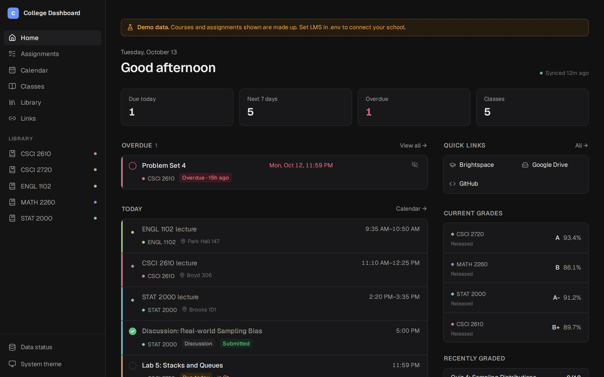
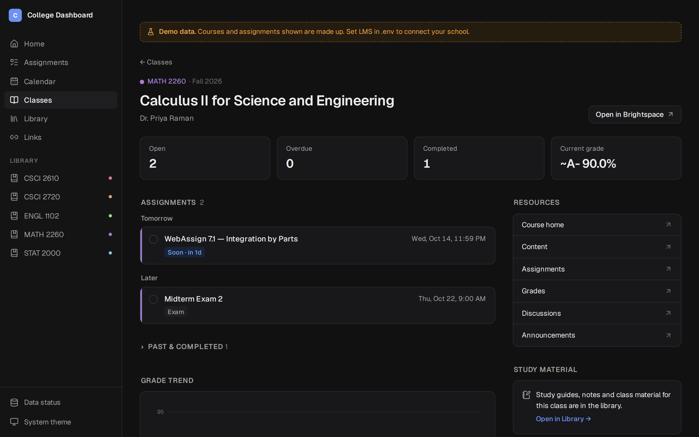
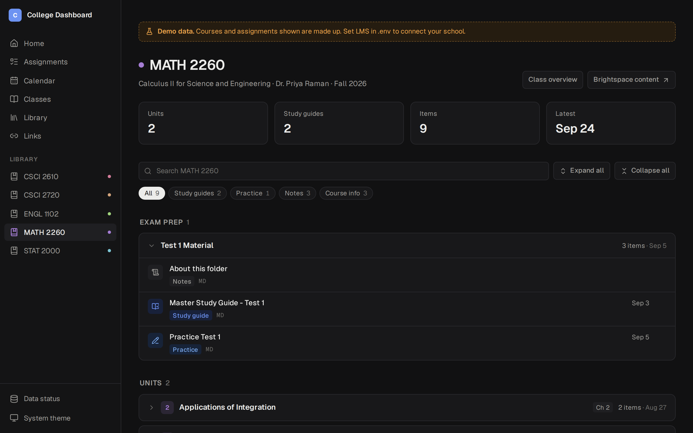
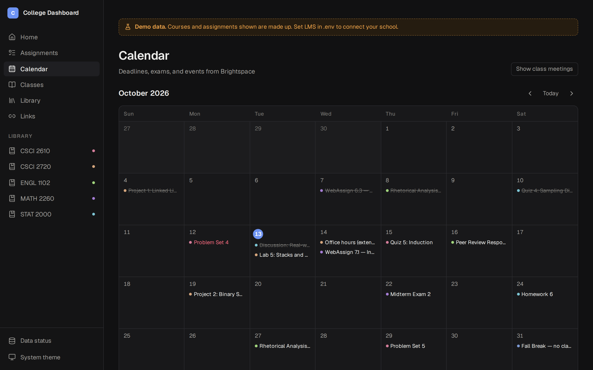
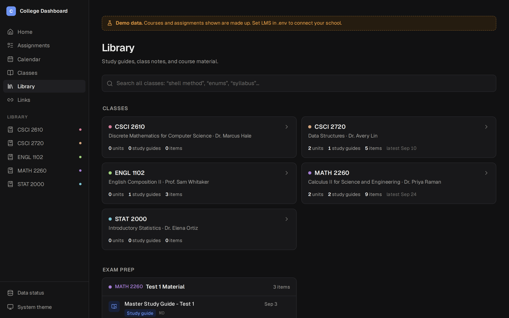
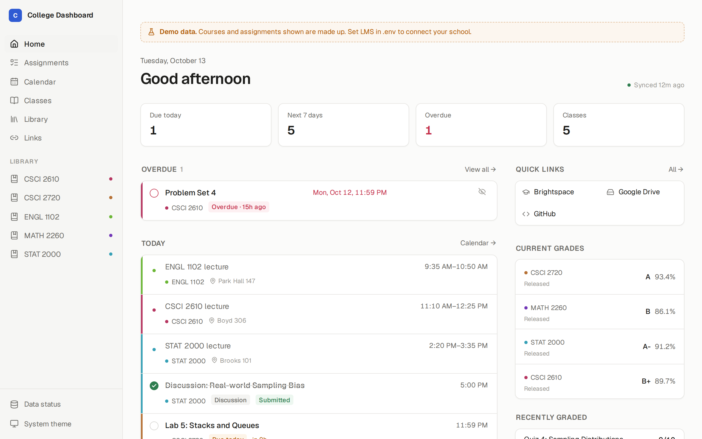
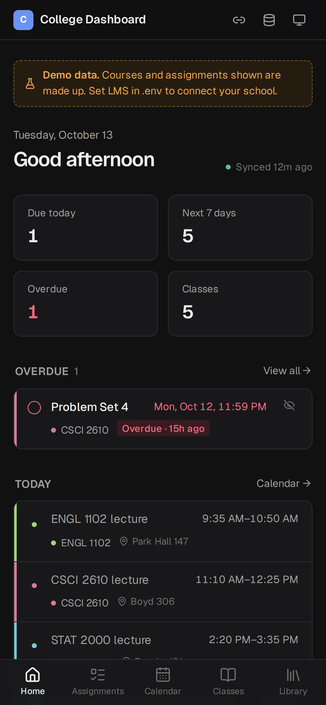

# College Dashboard

A self-hosted homepage for college: your classes, assignments, due dates,
calendar, grades and announcements from your school's LMS, plus a **library**
of your own study material (notes, study guides, slides, classwork) organized
per class.

- **Dashboard:** what's due today, this week, and overdue; a calendar;
  estimated current grades (from your syllabus weights) and GPA; announcements.
  Tick off items the LMS can't confirm, see your workload per week, count down
  to exams (linked to their study folders), and work out what you need on the
  rest of a class. "New" marks what changed since your last visit.
- **On your phone:** add it to your home screen (it installs like an app), and
  subscribe to `/api/calendar.ics` for deadlines with reminders in your
  calendar app. Optional push alerts through ntfy or Discord for new grades,
  announcements, and when the LMS sign-in needs you.
- **Library:** browses your class folders on disk, with search, filters, and
  in-browser viewing of PDFs, Markdown, code, images, video, and Office files
  (converted to PDF).
- **Read-only:** it never submits, posts, or changes anything in your LMS, and
  never writes to your folders.
- **LMS support:** Brightspace / D2L (tested), Canvas (new; built from the API
  docs, not yet tested against a live school).

Runs in Docker, on your laptop or a home server. It has **no login**, so keep it
on localhost, your LAN, or a VPN like Tailscale. Never expose it to the internet
(see [SECURITY.md](SECURITY.md)).



| Class page | Library |
|---|---|
|  |  |

<details>
<summary>More screenshots</summary>

| Calendar | Library home |
|---|---|
|  |  |

| Light theme | Phone |
|---|---|
|  |  |

</details>

## Quick start (demo data)

```bash
git clone https://github.com/jriddlec/college-dashboard
cd college-dashboard
cp .env.example .env
mkdir -p data previews d2l-auth
docker compose up -d --build
```

Open http://localhost:3000. With `LMS=fixture` (the default) it shows demo data
with a banner, and the library shows `examples/library`, so you can look around
before connecting anything.

Create the folders before the first start: Docker creates missing ones as root,
and the containers run as `PUID`/`PGID` (your user; check with `id`).

## Connect your school

### Brightspace / D2L

1. In `.env`, set:
   ```env
   LMS=d2l
   LMS_URL=https://yourschool.brightspace.com   # the address you see when signed in
   COMPOSE_PROFILES=d2l
   ```
   Optional: `LMS_LABEL` (what your school calls it, e.g. "eLC"),
   `SCHOOL_NAME`, `ACCENT_COLOR`, `SCHOOL_TZ`.
2. `docker compose up -d --build`
3. Open http://localhost:6080/vnc.html, click **Connect**, and sign in to your
   LMS in the browser there (SSO, Duo, and so on work as usual). On a server,
   tunnel the port first: `ssh -L 6080:127.0.0.1:6080 yourserver`.
4. The first sync runs within a few minutes, then every 30 minutes
   (`SYNC_INTERVAL`). Check **Data status** in the app.

The `d2l-session` container keeps one browser signed in and keeps a fresh API
token for the sync, using [d2l-cli](https://pypi.org/project/d2l-cli/). If the
session expires (a restart, or your school's limit), the app shows a warning
and keeps the last data; sign in again through noVNC. Your password is never
stored; the session's cookies and token stay in `D2L_AUTH_DIR`. More in
[docs/d2l.md](docs/d2l.md).

### Canvas

1. In Canvas: **Account → Settings → New Access Token**; copy the token.
2. In `.env`, set:
   ```env
   LMS=canvas
   LMS_URL=https://yourschool.instructure.com   # the address you see in the browser
   CANVAS_TOKEN=paste-the-token-here
   COMPOSE_PROFILES=canvas
   ```
3. `docker compose up -d --build`. The first sync runs right away, then every
   30 minutes.

The token stays in `.env` and the `canvas-sync` container (the web app never
sees it), and the sync only reads. When the token expires, the app keeps the
last data and tells you to make a new one. Details and troubleshooting:
[docs/canvas.md](docs/canvas.md).

## Your class folders (the library)

Point `LIBRARY_DIR` in `.env` at the folder where you keep class material. A
class owns the top-level folders named after its course code, with or without
the space (`CSCI 1301/`, `MATH2260 Notes/`); other names can be assigned in
`config/courses.json`. Any layout works, and `Notes`, `Classwork` and
`Important Documents` folders get extra structure (units, exam prep, dates,
kinds of material).

```bash
docker compose run --rm init --dry-run   # folders it would create for classes that have none
docker compose run --rm init             # create them (never touches existing folders)
docker compose run --rm convert          # Word/PowerPoint/Excel -> PDF previews
```

The full guide, with every folder and file-name convention:
[docs/library.md](docs/library.md). `examples/library` has one class in each
layout.

## Settings

Everything is optional. Copy the examples in `config/` and edit:

| File | What it does |
|---|---|
| `courses.json` | Rename classes, set instructors and icons, assign library folders, hide enrollments, add library-only classes |
| `links.json` | Quick links on the home page, and per-class links |
| `grading.json` | Syllabus weights and letter scales, for estimated grades |
| `syllabus.json` | Deliverables from the syllabus that the LMS doesn't list yet |
| `webassign.json` | WebAssign assignments, kept by hand |
| `transcript.json` | Completed GPA hours and quality points, for the GPA widget |

Changes apply without a restart. An invalid file is ignored and reported on the
**Data status** page.

Alerts and sign-in help come from `.env`: `NOTIFY_URL` (an ntfy topic URL, a
Discord webhook, or any URL that takes a JSON POST) and `APP_URL` (so alerts
link back to the dashboard) for the sync containers; `SIGNIN_URL` and
`SIGNIN_HINT` for the **Sign in** button on Data status when a Brightspace
session expires.

## On a home server

Use the same `compose.yml`: set the paths and ports in `.env`, and put anything
specific to your server (a reverse proxy network, labels) in a
`compose.override.yml` next to it. Examples for Caddy, Traefik, Tailscale, the
D2L sign-in over SSH, updates and backups: [docs/homelab.md](docs/homelab.md).

## Development

```bash
npm install
npm run dev        # http://localhost:3000, demo data unless .env.local sets LMS
npm test
npm run typecheck
npm run lint
python3 scripts/test_canvas_sync.py   # Canvas sync against a mock API (Linux/macOS)
```

`.env.local` takes the same settings as `.env`. Without Docker, the app reads
`./data`, `./config`, `./library` and `./previews` by default.

How it fits together:

- `scripts/d2l_sync.py` and `scripts/canvas_sync.py` (in the sync containers)
  write a timestamped snapshot of LMS data to `DATA_DIR/d2l/` or
  `DATA_DIR/canvas/` and swap `current` atomically, so the app never reads a
  half-written sync.
- `src/lib/school/d2l/normalize.ts` and `src/lib/school/canvas/normalize.ts`
  are the only code that knows each LMS's data shapes; everything else uses
  the types in `src/lib/school/types.ts`. Canvas sample responses for tests
  are in `src/lib/school/canvas/fixtures/`.
- `src/lib/library/catalog.ts` turns the folder tree into units, exam prep and
  classwork (pure, unit-tested).
- `src/lib/config.ts` and `src/lib/settings.ts` hold all configuration.

## License

MIT. See [LICENSE](LICENSE).
